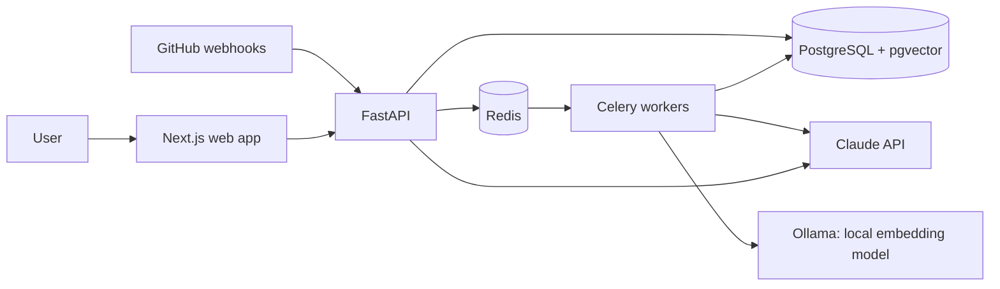

<div align="center">

# DevAssist

**Ask questions about any codebase. Get answers with file-and-line citations. Get every pull request reviewed automatically.**

[](https://github.com/Prathmesh2492004/devassist/actions/workflows/ci.yml)
[](LICENSE)


</div>

> **Status:** 🚧 Week 2 of 8 complete: repositories are cloned, split into functions and classes, embedded, and stored for search. See the [roadmap](#roadmap).

## Features

| | Feature | Status |
|---|---|---|
| 💬 | **Codebase Q&A with citations.** Ask "Where do we validate JWTs?" and get a streamed answer that links to the exact files and lines it used. | Week 3 |
| 🔍 | **Automatic PR reviews.** A GitHub App reads each new pull request, pulls related code from the index, and posts inline comments on likely bugs. | Week 4 |
| 📊 | **Quality and cost dashboard.** Tracks answer accuracy on a test set, latency, tokens and cost per question. | Week 8 |

## Architecture



Slow work (indexing repositories, reviewing pull requests) runs in background workers so the API stays fast. PostgreSQL stores both app data and vector embeddings, so there is one database to run and filters by repo or user are plain SQL joins.

## Tech stack

| Layer | Technology |
|---|---|
| **Backend** | Python 3.12, FastAPI, SQLAlchemy 2, Alembic, Celery |
| **Data** | PostgreSQL 16 with pgvector, Redis 7 |
| **Frontend** | Next.js 15 (App Router), TypeScript, Tailwind CSS |
| **AI** | Claude API, Qwen3-Embedding via Ollama (local) or Voyage AI, tree-sitter parsing |
| **DevOps** | Docker Compose, GitHub Actions, AWS with Terraform |
| **Quality** | pytest, Ruff, mypy (strict), ESLint, Dependabot |

## Getting started

### Prerequisites

- [Docker Desktop](https://www.docker.com/products/docker-desktop/)

### Run the full stack

```bash
git clone https://github.com/Prathmesh2492004/devassist.git
cd devassist
cp .env.example .env
docker compose up --build
```

Open http://localhost:3000/dashboard, paste a public repo such as `pallets/flask`, and watch it index.

| Service | URL |
|---|---|
| Web app | http://localhost:3000 |
| API docs (Swagger) | http://localhost:8000/docs |
| Readiness check | http://localhost:8000/health/ready |

<details>
<summary><b>Run without Docker</b></summary>

You need Python 3.12+, Node 22+, and Postgres (with pgvector) and Redis running locally.

```bash
# API
cd api
python -m venv .venv
source .venv/bin/activate          # Windows: .venv\Scripts\activate
pip install -e ".[dev]"
alembic upgrade head
uvicorn app.main:app --reload

# Web (in a second terminal)
cd web
npm install
npm run dev
```

</details>

## Development

Every pull request runs these checks in [GitHub Actions](.github/workflows/ci.yml). Run them locally before pushing:

```bash
# API: lint, format, strict type check, tests
cd api && ruff check . && ruff format --check . && mypy app tests && pytest

# Web: lint, type check, production build
cd web && npm run lint && npx tsc --noEmit && npm run build
```

Database tests run against real Postgres with pgvector (start it with `docker compose up -d db`). Each test runs in a transaction that is rolled back, and the test database is built by running every migration down and up, so broken migrations never reach `main`.

## How indexing works

1. **Clone.** A shallow clone (`--depth 1`) of the public repo fetches only the latest commit.
2. **Filter.** Dependencies, build output, lockfiles, minified, generated and binary files are skipped. Symlinks are never followed.
3. **Chunk.** [tree-sitter](https://tree-sitter.github.io/) parses Python, JavaScript, TypeScript and Java and splits them at function, class and method boundaries, keeping the comments and decorators above each one. Large classes are split into a header plus one chunk per method. Other files fall back to overlapping 60-line windows.
4. **Embed.** Chunks are turned into 1024-dimensional vectors in batches, with retries and backoff. See [Embedding providers](#embedding-providers).
5. **Store.** New chunks replace the old ones in a single transaction, so search never sees a half-indexed repo. Each chunk keeps its path, exact line range and commit SHA for citations.

Each chunk is searchable two ways: an **HNSW vector index** for meaning ("where do we retry payments?") and a **Postgres full-text index** for exact identifiers (`verify_jwt`). Week 3 combines both.

| Repo | Lines | Files | Chunks | Clone + parse |
|---|---|---|---|---|
| pallets/flask | 34,573 | 204 | 1,255 | 5.8 s |
| encode/httpx | 23,515 | 95 | 1,187 | 13.0 s |

<sub>Measured locally before embedding.</sub>

### Embedding providers

| | Ollama (default) | Voyage AI |
|---|---|---|
| Model | `qwen3-embedding:0.6b` | `voyage-code-3` |
| Cost | Free | 200M free tokens, then paid |
| Limits | None | 3 requests/min until a payment method is added |
| Privacy | Code never leaves your machine | Code is sent to Voyage |
| Speed (Flask, 1,255 chunks) | About 7 min on a GTX 1650 GPU; over an hour on a laptop CPU | Seconds to minutes |

Switch with `EMBEDDING_PROVIDER=voyage` and `VOYAGE_API_KEY=...` in `.env`, then re-index. Both produce 1024-dimensional vectors, so no database change is needed. The first `docker compose up` downloads the Ollama image and the 639 MB model once. With an NVIDIA GPU, add `COMPOSE_FILE=docker-compose.yml;docker-compose.gpu.yml` to `.env` (use `:` instead of `;` on macOS/Linux).

## API

| Method | Path | What it does |
|---|---|---|
| `POST` | `/repos` | Connect a public repo (`{"full_name": "owner/name"}`) and start indexing |
| `GET` | `/repos` | List repos with status, progress and stats |
| `GET` | `/repos/{id}` | One repo |
| `POST` | `/repos/{id}/reindex` | Index again from the latest commit |
| `DELETE` | `/repos/{id}` | Remove a repo and its index |

Interactive docs are at http://localhost:8000/docs.

## Project structure

```
devassist/
├── api/                    FastAPI backend
│   ├── app/
│   │   ├── ingest/         Clone, filter, chunk (tree-sitter), embed, store
│   │   ├── routes/         HTTP endpoints
│   │   ├── models.py       SQLAlchemy models
│   │   ├── worker.py       Celery app and tasks
│   │   └── main.py         App factory
│   ├── migrations/         Alembic migrations
│   └── tests/
├── web/                    Next.js frontend
│   └── src/
│       ├── app/            Pages (landing, dashboard)
│       └── components/
├── infra/                  Terraform for AWS (Week 7)
├── docs/                   Screenshots and design notes
├── .github/                CI, Dependabot, issue and PR templates
└── docker-compose.yml      Full local stack
```

## Roadmap

- [x] **Week 1: Foundations.** Monorepo, FastAPI and Next.js skeletons, Docker Compose, CI
- [x] **Week 2: Ingestion.** Clone repos, chunk code with tree-sitter, store embeddings in pgvector
- [ ] **Week 3: Retrieval.** Hybrid search, reranking, streamed answers with citations
- [ ] **Week 4: GitHub App.** Webhooks and automatic inline PR reviews
- [ ] **Week 5: Product.** GitHub sign-in, multiple repos, rate limiting, incremental re-indexing
- [ ] **Week 6: Quality.** 50-question evaluation set, accuracy gate in CI, 80% test coverage
- [ ] **Week 7: Deploy.** AWS with Terraform, HTTPS, CI/CD, monitoring
- [ ] **Week 8: Launch.** Metrics dashboard, demo video, real users

## Screenshots

| Landing page | Dashboard |
|---|---|
|  |  |

## License

[MIT](LICENSE) © 2026 Prathmesh Bhilegaonkar
